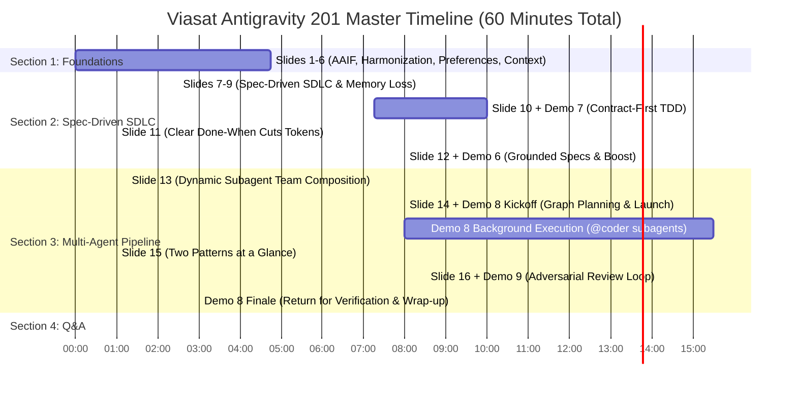

# Antigravity Advanced 201: Spec-Driven Development & Multi-Agent Workflows
### Viasat Engineering Enablement — Comprehensive Run-of-Show & Presenter Flight Plan

> **Session Target:** 60 Minutes Total (48m Content & Demos + 12m Open Q&A Buffer)  
> **Slide Talk Time:** ~12m 30s | **Live Demo Wall-Clock Time:** ~35m 30s | **Q&A Buffer:** 12m 00s  
> **Key Architecture Pattern:** Concurrent "Cooking Show" Execution Pipeline (Demo 8 Kickoff $\rightarrow$ Demo 9 Concurrent Execution $\rightarrow$ Demo 8 Finale) backed by deterministic sub-second environment resets (`./start_demo.sh 201`).

---

## Master Timeline & Concurrency Architecture

---

## Detailed Run-of-Show & Presenter Cue Sheet

### Section 1: Foundations & Context (~4m 45s)

| Timestamp | Slide & Topic | Duration | Key Talking Points & Visual Cues |
|---|---|:---:|---|
| **00:00 - 00:30** | **Slide 1: Cover** — *Antigravity 201: Spec-Driven Development & Multi-Agent Workflows* | 0:30 | <ul><li>Welcome Viasat engineering team.</li><li>Focus: Moving past single-turn chat prompts into deterministic, spec-driven engineering and coordinated multi-agent pipelines.</li></ul> |
| **00:30 - 01:30** | **Slide 2: Open Agentic Foundations** *(Linux Foundation AAIF)* | 1:00 | <ul><li>Explain Linux Foundation AAIF open standards: instructions (`AGENTS.md`), reusable playbooks (`.agents/skills/`), and tool interfaces (`.mcp.json`).</li><li>No vendor lock-in: standardized files work across agent platforms.</li></ul> |
| **01:30 - 02:30** | **Slide 3: Cross-Tool Harmonization** *(Single Source of Truth)* | 1:00 | <ul><li>How backward-compatible symlinks (`.cursorrules -> AGENTS.md`, `CLAUDE.md -> AGENTS.md`, `GEMINI.md -> AGENTS.md`) allow teams using Cursor, Claude Code, and Antigravity to share a single repo configuration.</li></ul> |
| **02:30 - 03:15** | **Slide 4: Inside Global Preferences** *(`~/.gemini/`)* | 0:45 | <ul><li>Quick tour of user-level config: `settings.json`, global rules, skills, and model defaults.</li><li>Separation between machine-level defaults and repository-pinned constraints.</li></ul> |
| **03:15 - 04:00** | **Slide 5: Hierarchical Context** *(`AGENTS.md` / `GEMINI.md`)* | 0:45 | <ul><li>Context inheritance hierarchy: Global (`~/.gemini/`) + Root (`./AGENTS.md`) + Subdirectory (`src/.../AGENTS.md`) auto-merging.</li><li>Path-scoped specificity prevents context pollution.</li></ul> |
| **04:00 - 04:45** | **Slide 6: Context Usage** *(`/context` TUI)* | 0:45 | <ul><li>Progressive disclosure: keeping standing context under 15% to reserve maximum context headroom and attention budget for complex reasoning.</li></ul> |

---

### Section 2: Spec-Driven Development + Demos 7 & 6 (~21m 30s)

| Timestamp | Slide & Topic | Duration | Presenter Actions, Cues & Exact Prompts |
|---|---|:---:|---|
| **04:45 - 05:00** | **Slide 7: Section Header** — *Spec-Driven Development* | 0:15 | <ul><li>Transition: Ambiguous prompts burn tokens, produce hallucinations, and require endless manual review. Specs fix this.</li></ul> |
| **05:00 - 06:15** | **Slide 8: "An elephant never forgets"** | 1:15 | <ul><li>Two-phase architecture: Phase 1 discovery/interview (`/grill-me`) $\rightarrow$ Phase 2 contract locked on disk (`/plan` $\rightarrow$ `docs/specs/0001-stock-reservation-holds.md` / `.scratch/reservation-plan.md`) *before* writing code.</li></ul> |
| **06:15 - 07:15** | **Slide 9: "Short-term memory loss is a feature!"** | 1:00 | <ul><li>Once the spec and plan are written to disk, clear discovery chat clutter (`/clear`). Cold execution from disk avoids cognitive drift and prevents prompt confusion.</li></ul> |
| **07:15 - 17:15** | **Slide 10 + Live Demo 7:** *Contract-First Spec Clarification & TDD (`demo7-contract-spec-tdd`)* | **10:00** *(0:30 slide + 9:30 demo)* | **Live Workbench Actions (`workspace/`):** 1. **Baseline Failing Tests (`Red` State):** `pytest -q` *Expected:* `1 passed, 4 failed` 2. **Edge-Case Interview (`/grill-me`):** `/grill-me Review @docs/specs/0001-stock-reservation-holds.md and tests/test_reservator.py. Ask me about any edge cases before we lock the implementation plan.` *Highlight:* Interactive modal answers clock drift, lock lease times, and idempotency retention. 3. **Lock Plan to Disk:** `/plan Write the implementation plan and task breakdown to .scratch/reservation-plan.md` 4. **Autonomous Test-Heal Loop (`Green` State):** `/goal Implement .scratch/reservation-plan.md in src/inventoryservice/reservator.py and self-heal until pytest passes 100%.` *Expected:* `5 passed in 0.05s`. |
| **17:15 - 18:15** | **Slide 11: "Why a clear 'done-when' cuts token use"** | 1:00 | <ul><li>Vague prompt = unbounded entropy.</li><li>Explicit "Done when: 100% pytest pass with 0 warnings" gives the agent a deterministic, self-terminating stop condition.</li></ul> |
| **18:15 - 26:15** | **Slide 12 + Live Demo 6:** *Grounded Specs & `⚡ Boost` (`demo6-linked-design-boost`)* | **08:00** *(0:30 slide + 7:30 demo)* | **Live Workbench Actions (`workspace/`):** 1. **Inspect 3-Tier Hierarchy:** Show `AGENTS.md` (constitution) linking to Architectural Decision Record `@docs/adr/0001-decimal-currency-and-discount-caps.md` (standing production guardrails: Decimal currency, 50% discount ceiling) vs. `@docs/specs/0001-stacked-promo-engine.md` (conversation feature spec). 2. **Baseline Green Tests:** `pytest -q` (`2 passed`). 3. **Single-Turn Boost Implementation:** `/boost Implement @docs/specs/0001-stacked-promo-engine.md in src/discountservice/engine.py and add unit tests for all acceptance criteria.` *Expected:* Generates `evaluate_stacked_promos` and full tests; `8 passed`. |

---

### Section 3: Multi-Agent Workflows + Demos 8 & 9 (~21m 45s)

> [!IMPORTANT]
> **The Concurrent "Cooking Show" Execution Pipeline:**  
> Demo 8's multi-agent refactor takes ~15.5 minutes of background execution. To keep the presentation dynamic and eliminate dead air:
> 1. Launch Demo 8 Stage 3 (`/teamwork` execution) at **27:30**.
> 2. Observe the initial `@coder` subagent allocations in the Antigravity TUI for ~2 minutes.
> 3. Leave Demo 8 running in the background; switch to **Slides 15–16 and Demo 9** (~9m 30s).
> 4. Return to Demo 8 at **45:00** for the grand finale verification!

| Timestamp | Slide & Topic | Duration | Presenter Actions, Cues & Exact Prompts |
|---|---|:---:|---|
| **26:15 - 27:30** | **Slide 13: Dynamically configured subagents to assemble an agent team** | 1:15 | <ul><li>Show `.agents/agents/*.md`: model routing (`model: pro` for `@architect` vs `model: flash` for `@fast-scout`), tool permissions, and strictly scoped file boundaries per agent persona.</li></ul> |
| **27:30 - 35:30** | **Slide 14 + Live Demo 8 (Kickoff):** *Graph-Planned `/teamwork` (`demo8-teamwork-monolith-refactor`)* | **08:00** *(0:30 slide + 7:30 live)* | **Live Workbench Actions (`workspace/`):** 1. **Baseline Tests:** `pytest -q` (`4 passed`). 2. **Graph Planning (DAG + Mermaid):** `/plan Use @architect and @fast-scout to inspect src/order_app/monolith_order_app.py and @docs/adr/0001-order-service-layered-decomposition.md via the ast-graph MCP tools and generate a 3-stage dependency graph (DAG) in .scratch/refactor-dag.md with non-overlapping file ownership. Include the assigned subagent for each step in both the stage breakdown and the Mermaid diagram.` *Approve plan (`Continue.`):* Agent outputs `.scratch/refactor-dag.md` with visual Mermaid flowchart. 3. **Launch Multi-Agent `/teamwork` Execution:** `/teamwork Execute .scratch/refactor-dag.md using @coder subagents in parallel across Stage 2 (repositories.py and services.py), then rewire routes.py and monolith_order_app.py and verify pytest passes in a clean context.` 4. *Action:* Type `Approved.` Watch initial `@coder` subagents spin up in TUI for 1–2 minutes, then explain: *"While our agent team decomposes the monolith in the background, let's examine our second multi-agent pattern."* |
| **35:30 - 36:30** | **Slide 15: The two patterns at a glance** | 1:00 | <ul><li>Contrast **Parallel Fan-Out** (Demo 8: disjoint file authoring across subagents) vs. **Generator-Critic / Adversarial Verification** (Demo 9: clean-context auditing against standing design rules).</li></ul> |
| **36:30 - 45:00** | **Slide 16 + Live Demo 9:** *Adversarial Review Loop (`demo9-adversarial-review-loop`)* | **08:30** *(0:30 slide + 8:00 live)* | **Live Workbench Actions (`workspace/`):** 1. **The "False Green" Illusion:** `pytest -q` *Expected:* `4 passed in 0.02s` (Author assumes code is production-ready). 2. **Clean-Context Adversarial Audit:** `Invoke @adversarial-reviewer to audit src/settlement/dispatcher.py and tests/test_dispatcher.py against @docs/adr/0001-payment-webhook-and-settlement-guardrails.md and produce a production guardrail table with file:line proof.` *Expected:* Surfaces 3 critical flaws (linear backoff, non-constant-time HMAC compare, outbox order reversal). 3. **Remediate Findings:** `/boost Fix all FAIL findings identified by @adversarial-reviewer in src/settlement/dispatcher.py, add regression tests in tests/test_dispatcher.py, and re-run @adversarial-reviewer to confirm 100% PASS.` *Expected:* `7 passed in 0.05s` with 100% PASS audit table. |
| **45:00 - 48:00** | **Demo 8 Finale:** *Decomposed Monolith Verification* | **03:00** | **Return to Demo 8 Terminal / Workspace:** 1. Inspect completed refactoring output in chat. 2. Show new modular files: `models.py`, `repositories.py`, `services.py`, `routes.py`. 3. Point out `monolith_order_app.py` preserved as a clean backward-compatible facade. 4. Run final verification: `pytest -q` (`4 passed`). |

---

### Section 4: Q&A & Wrap-Up (~12m 00s)

| Timestamp | Phase | Duration | Details |
|---|---|:---:|---|
| **48:00 - 60:00** | **Open Engineering Q&A & Wrap-Up** | 12:00 | <ul><li>Open discussion with Viasat engineering leadership and attendees.</li><li>Address enterprise adoption questions, subagent routing patterns, and next steps for team workflows.</li><li>Buffer absorbs any live network variance without overflowing the 60-minute mark.</li></ul> |
