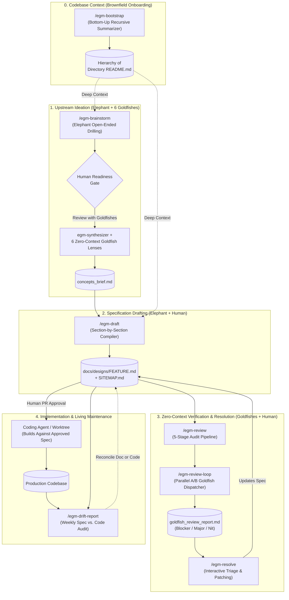
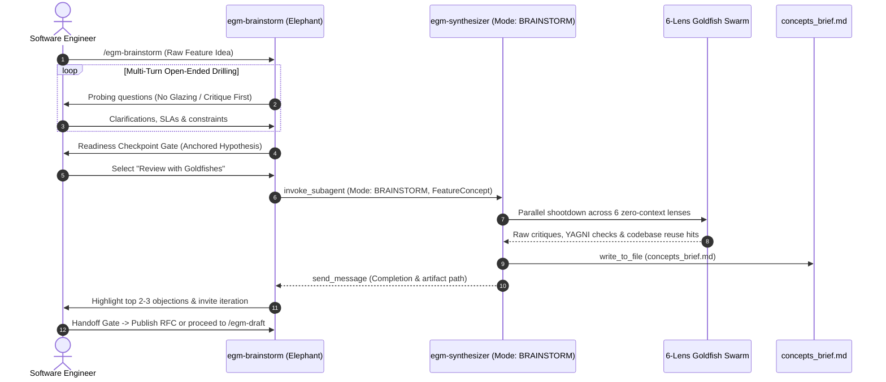
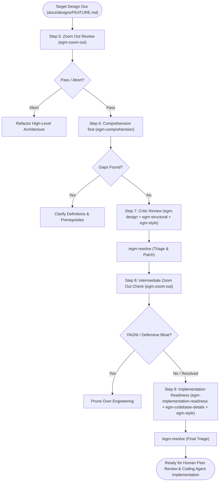

# Elephant-Goldfish Model (EGM) — End-to-End Lifecycle & Skill Architecture

> **Design with an Elephant (full project context). Review with a Goldfish (zero conversation context).**  
> Reference overview of how all **7 EGM skills**, **9 subagent personas**, **3 roles (Human, Elephant, Goldfish)**, and **checked-in artifacts** fit together across the software engineering lifecycle.

---

## 1. Unified Process Across All 7 EGM Skills

---

## 2. How the 7 Skills Map to the Lifecycle

| Stage | Skill | Active Role(s) | Input $\rightarrow$ Output Artifact | When to Use |
| :--- | :--- | :--- | :--- | :--- |
| **0. Context Setup** | `/egm-bootstrap` | Elephant + `egm-bootstrap-orchestrator` | Source tree $\rightarrow$ Bottom-up `README.md` hierarchy | Onboarding an existing brownfield repository so the Elephant can navigate architecture cheaply. |
| **1. Ideation** | `/egm-brainstorm` | Elephant + `egm-synthesizer` + 6 Goldfish Lenses | Raw feature idea $\rightarrow$ `concepts_brief.md` (or RFC in `docs/designs/`) | Stress-testing a "half-baked" idea before investing in a full design specification. |
| **2. Spec Drafting** | `/egm-draft` | Elephant + Human Checkpoints | `concepts_brief.md` $\rightarrow$ `docs/designs/<feature>.md` + `SITEMAP.md` | Turning an agreed concept brief into a formal design specification, section by section. |
| **3a. Full Audit** | `/egm-review` | 5-Stage Goldfish Pipeline | `docs/designs/<feature>.md` $\rightarrow$ `goldfish_review_report.md` | Running the full 5-stage zero-context audit (Zoom Out $\rightarrow$ Comprehension $\rightarrow$ Critic $\rightarrow$ Zoom Out $\rightarrow$ Readiness). |
| **3b. Targeted Audit** | `/egm-review-loop` | `egm-synthesizer` + Selected Goldfishes (A/B) | Specific file/line range $\rightarrow$ `goldfish_review_report.md` | Running a specific subset of Goldfish reviewers on a targeted section or document. |
| **4. Triage & Fix** | `/egm-resolve` | Human + Elephant | `goldfish_review_report.md` $\rightarrow$ Patched `docs/designs/<feature>.md` | Stepping through Blocker/Major/Nit findings interactively and applying approved edits. |
| **5. Maintenance** | `/egm-drift-report` | Drift Auditor | Checked-in `docs/designs/*.md` + live source tree $\rightarrow$ Drift report | Periodic (e.g., weekly) audit to catch divergence between production code and design specs. |

---

## 3. Deep Dive: `/egm-brainstorm` Sequence (`Mode: BRAINSTORM`)

---

## 4. Deep Dive: `/egm-review` 5-Stage Pipeline (`Mode: REVIEW`)

---

## 5. The 9 Registered Agent Personas (`agents/`)

| Agent Name | Role in EGM | Context Mode | Primary Responsibility |
| :--- | :--- | :--- | :--- |
| `egm-synthesizer` | Swarm Compiler & Orchestrator | Intermediate Subagent | Spawns parallel Goldfish subagents, deduplicates findings, triages severity (🔴 Blocker, 🟡 Major, 🟢 Nit), and writes artifacts. |
| `egm-zoom-out` | Skeptical Architect | Zero-Context Goldfish | Enforces simplicity, YAGNI, high-level focus, and searches codebase for existing components to reuse. |
| `egm-design` | Hostile Design Critic | Zero-Context Goldfish | Challenges scalability, SPOFs, quota/token economics, latency budgets, and failure modes. |
| `egm-codebase-details` | Technical Quality Auditor | Zero-Context Goldfish | Verifies exact file paths, proto schemas, function signatures, and backward compatibility against live code. |
| `egm-comprehension` | Naive Reader | Zero-Context Goldfish | Audits documents with zero assumed institutional knowledge; flags undefined terms and ergonomic friction. |
| `egm-implementation-readiness` | Pragmatic Tech Lead | Zero-Context Goldfish | Verifies unambiguous execution instructions, observability/SRE telemetry, and testability. |
| `egm-structural` | Document Architect | Zero-Context Goldfish | Audits structural symmetry, long-term maintainability, Coupling/Tech Debt, and template compliance. |
| `egm-style` | Technical Copy Editor | Zero-Context Goldfish | Enforces plain English, strips promotional buzzwords/adverbs, and ensures precision. |
| `egm-bootstrap-orchestrator` | Documentation Bootstrapper | Orchestrator Subagent | Partitions directory trees for bottom-up recursive `README.md` generation during `/egm-bootstrap`. |
