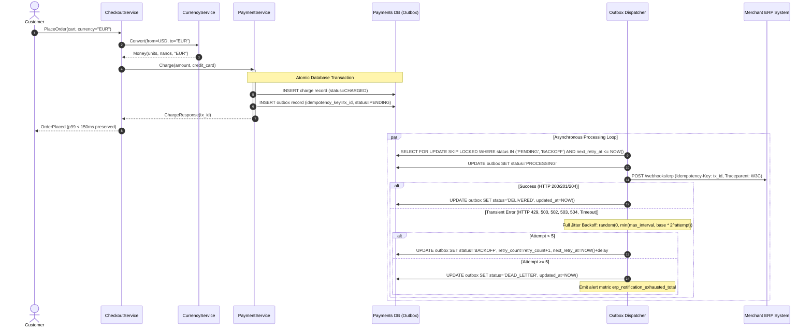

# Asynchronous Merchant ERP Settlement Outbox with Deterministic FX Conversion

* **Author:** @architecture-team
* **Status:** Proposed
* **Date:** 2026-10-27

--------------------------------------------------------------------------------

## Overview

Online Boutique requires order settlement reporting to external merchant Enterprise Resource Planning (ERP) systems in each merchant's local currency. To preserve checkout availability and adhere to the 150ms p99 checkout latency budget, this design moves foreign exchange (FX) conversion to the internal `CurrencyService` and isolates third-party merchant ERP integrations from the critical checkout path using an asynchronous transactional outbox.

## The Problem

Merchants operating on Online Boutique require settlement data pushed to their back-office ERP systems following card capture. Coupling merchant ERP webhook delivery directly to the checkout flow introduces severe reliability and latency failure modes:

1. **Checkout Latency SLA Violations**: Third-party ERP webhooks exhibit variable network response times (500ms–5000ms) and occasional downtime. Executing synchronous HTTP requests inside `PaymentService.Charge` violates the 150ms p99 checkout SLA mandated in repository governance (`AGENTS.md §2`).
2. **Cascading Failure & Lost Orders**: When merchant ERP systems experience outages or return 500 errors, synchronous checkout calls either fail customer purchases after cards have already been charged or drop merchant notifications permanently.
3. **Financial Inaccuracy & Service Boundary Breaches**: Attempting FX conversion through external LLM endpoints introduces non-deterministic rounding, hallucination risks, per-token billing overhead, and violates service boundaries by bypassing the canonical `currencyservice`.

## Goals

* **Preserve Checkout Latency**: Guarantee that `PaymentService.Charge` completes within the 150ms p99 checkout latency SLA by eliminating synchronous third-party HTTP calls from the checkout critical path.
* **Deterministic FX Arithmetic**: Ensure all currency conversions use exact decimal representations and ECB-aligned rates via the existing `CurrencyService.Convert` gRPC endpoint in `protos/demo.proto`.
* **Guaranteed Event Delivery**: Achieve at-least-once asynchronous settlement notification to merchant ERP endpoints via an atomic transactional outbox pattern.
* **Resilient Retry Policy**: Implement retry loops using exponential backoff with full randomized jitter (`AGENTS.md §3.2`) to prevent thundering herd load on degraded ERP systems.
* **Duplicate Protection**: Include deterministic `Idempotency-Key` headers on all outbound ERP requests to prevent duplicate ledger entries.

## Non-Goals

* Calling external LLMs or third-party AI endpoints on the transaction path.
* Firing synchronous third-party HTTP webhooks during `PaymentService.Charge`.
* Supporting merchant-specific custom transformation plugins within `paymentservice`.
* Implementing distributed two-phase commit (2PC) transactions across microservice boundaries.

## Open Questions

* **Question 1**: Should the outbox dispatcher enforce strict per-merchant event ordering (FIFO), or is unordered at-least-once delivery with sequence numbers sufficient for merchant ERP consumption?
* **Question 2**: What retention period should be enforced for successfully delivered (`DELIVERED`) outbox rows before purging to control database table growth?

## Critical User Journeys (CUJs)

### CUJ 1: Successful Checkout and Asynchronous ERP Notification

* **Given**: A customer checks out a cart denominated in USD with a merchant whose ERP expects EUR settlement.
* **When**: The customer submits the order, `CheckoutService` queries `CurrencyService.Convert` for the EUR amount, and calls `PaymentService.Charge`.
* **Then**: `PaymentService` authorizes the payment, writes the payment record and an outbox event (`status=PENDING`) in a single atomic database transaction, and returns a successful response within 150ms. An asynchronous worker delivers the settlement notification to the merchant ERP with an `Idempotency-Key` header and marks the outbox record `DELIVERED`.

### CUJ 2: Merchant ERP Outage with Jittered Retry and DLQ Escalation

* **Given**: The merchant ERP endpoint is temporarily down (HTTP 503).
* **When**: The customer completes checkout.
* **Then**: The customer transaction succeeds without delay. The outbox dispatcher detects the 503 error, calculates sleep using exponential backoff with full randomized jitter, and retries up to 5 times. If the ERP remains offline after 5 attempts, the event transitions to `DEAD_LETTER` state and emits an operational alert metric for oncall triage.

## Technical Plan (Architecture)

### Architectural Overview

The architecture introduces a clean decoupling between card authorization and external merchant ERP notifications using the Transactional Outbox pattern.

### Component Breakdown

1. **CheckoutService & CurrencyService**:
   - `CheckoutService` continues orchestrating cart pricing and currency conversion through typed gRPC calls to `CurrencyService.Convert` (`protos/demo.proto`).
   - `CurrencyService` uses its in-memory European Central Bank (ECB) conversion table to compute exact unit and nano conversions deterministically.
2. **PaymentService (`Charge` RPC)**:
   - Evaluates card validity and charges the balance.
   - Encloses the payment record creation and outbox row insertion into a single atomic transaction.
   - Responds immediately to `CheckoutService` with `transaction_id`.
3. **Transactional Outbox Storage**:
   - Stores outbound webhook payloads in a dedicated `payment_outbox` table.
   - Schema:
     * `id`: UUID (Primary Key)
     * `idempotency_key`: VARCHAR(64) (Unique constraint, maps to `transaction_id`)
     * `merchant_id`: VARCHAR(64) (Indexed for query and partitioning)
     * `event_type`: VARCHAR(32) (e.g., `PAYMENT_SETTLED`)
     * `payload`: JSONB (Serialized settlement event details including currency and amount)
     * `status`: VARCHAR(16) (`PENDING`, `PROCESSING`, `BACKOFF`, `DELIVERED`, `DEAD_LETTER`)
     * `retry_count`: INT (Default: 0)
     * `next_retry_at`: TIMESTAMP WITH TIME ZONE (Default: `NOW()`)
     * `trace_context`: VARCHAR(256) (Serialized W3C `traceparent` for Cloud Trace continuity)
     * `created_at`: TIMESTAMP WITH TIME ZONE (Default: `NOW()`)
     * `updated_at`: TIMESTAMP WITH TIME ZONE (Default: `NOW()`)
4. **Asynchronous Outbox Dispatcher**:
   - Standalone worker running within the `paymentservice` deployment pod or as a co-located background process.
   - Uses non-blocking row-level locking (`SELECT ... FOR UPDATE SKIP LOCKED`) to support horizontal scale across multiple worker replicas without contention.
   - Transmits HTTP POST notifications with headers:
     * `Idempotency-Key`: Deterministic transaction identifier.
     * `traceparent`: Propagated OpenTelemetry trace context.
     * `Content-Type`: `application/json`.
5. **Retry Invariants & Jitter Calculation**:
   - Formula:
     $$\text{sleep} = \text{random}(0,\, \min(T_{\max},\, T_{\text{base}} \times 2^{\text{attempt}}))$$
   - Parameters:
     * $T_{\text{base}} = 0.5\text{s}$
     * $T_{\max} = 30.0\text{s}$
     * Max retry attempts: 5
   - Strict ban on fixed or linear sleeps (`time.sleep(1.0)`).

## Alternatives Considered

### Alternative 1: Synchronous Third-Party ERP Webhook in PaymentService.Charge

* **Description**: Execute an HTTP POST directly to the merchant's ERP endpoint within the synchronous execution of `PaymentService.Charge` before returning the gRPC response.
* **Pros**: Eliminates the need for a database outbox table, background polling workers, and state management.
* **Cons**:
  * Unbounded latency variance: Merchant ERPs often take 500ms–5000ms to process webhooks, which immediately breaches the mandatory 150ms p99 checkout SLA (`AGENTS.md §2`).
  * Fragile availability coupling: If the merchant ERP experiences downtime or network partitions, customer checkouts fail even if credit card authorization succeeds.
* **Reason for Rejection**: Directly violates checkout latency budgets and cascades third-party outages into primary revenue transactions.

### Alternative 2: External LLM for On-The-Fly FX Conversion

* **Description**: Call an external Large Language Model endpoint (e.g., Vertex AI / Gemini) during checkout to compute exchange rates and conversion math on the fly.
* **Pros**: Can parse arbitrary localized currency names or support dynamic rate negotiations without static configuration.
* **Cons**:
  * Financial non-determinism: LLMs can hallucinate decimals, introduce floating-point inaccuracies, and yield inconsistent prices for the same transaction.
  * Latency and cost overhead: Adds 300ms–2000ms per checkout and incurs per-token inference costs for an operation that requires basic multiplication.
  * Duplication of existing services: `CurrencyService` already implements deterministic ECB-backed currency conversion via typed gRPC in `protos/demo.proto`.
* **Reason for Rejection**: Currency arithmetic must be exact and deterministic. Calling an LLM adds failure modes, rate limits, and latency without any technical benefit.

### Alternative 3: Direct Message Broker Publish without Transactional Outbox (Dual-Write Pattern)

* **Description**: Publish directly to an external message broker (e.g., Google Cloud Pub/Sub or Kafka) immediately following database commit of the payment record.
* **Pros**: Eliminates outbox table storage and periodic database polling.
* **Cons**:
  * Dual-write failure: If the payment service crashes, restarts, or loses network connectivity immediately after the database commit but before the message broker publish call succeeds, the settlement event is permanently lost without a recovery record.
* **Reason for Rejection**: Fails the at-least-once delivery guarantee required for enterprise merchant financial reconciliation.

## Detailed Implementation Plan

### Affected Files and Components

1. **`src/paymentservice/schema.sql`** (Create)
   * **Rationale**: Define the relational schema for the `payment_outbox` table, including indexes on `(status, next_retry_at)` for efficient polling, and unique constraints on `idempotency_key` to guarantee at-most-once event registration per checkout transaction.

2. **`src/paymentservice/charge.py`** (Modify)
   * **Rationale**: Extend the `PaymentService.Charge` RPC implementation to wrap payment authorization, ledger update, and outbox event creation into a single atomic database transaction. Ensure `transaction_id` is assigned as the `idempotency_key` of the outbox entry.

3. **`src/paymentservice/outbox_worker.py`** (Create)
   * **Rationale**: Implement the background polling loop for the transactional outbox:
     * Executes `SELECT FOR UPDATE SKIP LOCKED` on pending and backoff records ready for dispatch.
     * Makes outbound HTTP POST calls with `Idempotency-Key` and W3C `traceparent` headers.
     * Implements full randomized jitter exponential backoff:
       $$\text{sleep} = \text{random}(0,\, \min(30.0,\, 0.5 \times 2^{\text{retry\_count}}))$$
     * Transitions records to `DEAD_LETTER` after 5 failed attempts and emits `erp_notification_exhausted_total`.

4. **`src/paymentservice/reconciler.py`** (Modify)
   * **Rationale**: Remediate the existing codebase defects identified by the review lenses:
     * Standardize identifier extraction using safe `.get("tx_id", record.get("transaction_id"))` to eliminate `KeyError` crashes on legacy records.
     * Replace forbidden linear delays (`time.sleep(1.0)`) with compliant exponential backoff with full jitter to comply with `AGENTS.md §3.2`.

5. **`tests/paymentservice/test_outbox_worker.py`** (Create)
   * **Rationale**: Comprehensive automated unit test suite verifying:
     * Correct outbox event insertion during payment charge transactions.
     * Accurate jitter calculation within range $[0,\, \min(30.0,\, 0.5 \times 2^{n})]$.
     * Immediate transition to `DELIVERED` on HTTP 200/201/204.
     * Status transition to `DEAD_LETTER` after 5 consecutive transient errors (HTTP 503/timeout).
     * Preservation and propagation of the `Idempotency-Key` header.

6. **`docs/designs/SITEMAP.md`** (Modify)
   * **Rationale**: Register the completed architecture RFC in the project's design registry.

### Implementation Checklist

* [ ] Define `payment_outbox` DDL in `src/paymentservice/schema.sql`.
* [ ] Integrate transactional outbox row write into `PaymentService.Charge` in `src/paymentservice/charge.py`.
* [ ] Build worker dispatch loop in `src/paymentservice/outbox_worker.py` with `SKIP LOCKED` query semantics.
* [ ] Implement full randomized jitter backoff calculation utility function.
* [ ] Remediate `KeyError` and `time.sleep` anti-patterns in `src/paymentservice/reconciler.py`.
* [ ] Write unit and integration tests in `tests/paymentservice/test_outbox_worker.py`.
* [ ] Verify test suite passes with zero warnings.
* [ ] Register RFC in `docs/designs/SITEMAP.md`.
